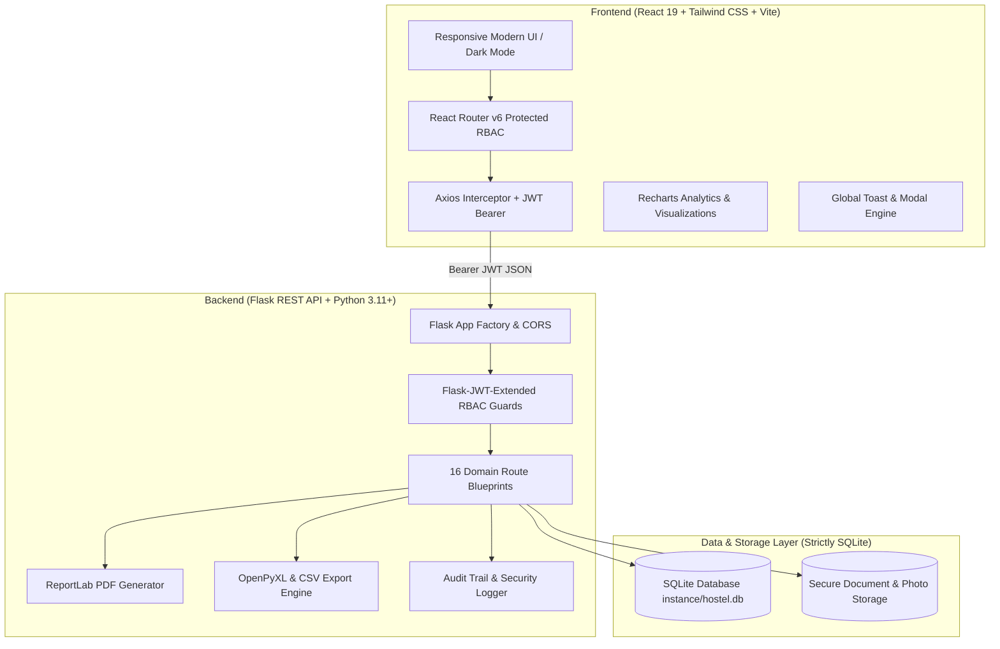

# Hostel Management System (HMS)

> **Enterprise-Grade, Full-Stack Hostel & Student Accommodation Management Platform**  
> Built with **React 19**, **Tailwind CSS**, **Python Flask**, and **SQLite**.

---

## 🌟 Executive Summary

The **Hostel Management System (HMS)** is a comprehensive, production-ready SaaS web application tailored for colleges, universities, and private student accommodation facilities. Designed with a modern, high-density dashboard interface and a robust RESTful Python backend, it automates daily boarding operations—from online admissions and visual bed allocations to fee billing with PDF invoices, attendance roll-calls, maintenance work orders, and mess menu scheduling.

---

## 🏗️ System Architecture



---

## ⚡ Technology Stack

### **Frontend**
- **Framework**: React 19 (`src/`) with Vite build tooling
- **Styling**: Tailwind CSS with custom slate/indigo SaaS palette & dark mode
- **Routing**: React Router v6 with strict Role-Based Access Control (RBAC) guards
- **Icons**: Lucide React
- **Charts & Data Viz**: Recharts (Area charts, Bar charts, Pie charts)
- **HTTP Client**: Axios with automatic JWT header injection and 401 interceptor
- **State & Context**: React Context (`AuthContext`, `ThemeContext`, `ToastContext`)

### **Backend**
- **Runtime**: Python 3.11+
- **Framework**: Flask & RESTful API Blueprint architecture
- **ORM & DB**: Flask-SQLAlchemy with SQLite (zero external database setup required)
- **Authentication**: Flask-JWT-Extended with role claims and token revocation handling
- **Password Security**: Werkzeug crypto security (`generate_password_hash`, `check_password_hash`)
- **Document Generation**: ReportLab (vector PDF invoices and receipts)
- **Data Export**: OpenPyXL (formatted multi-sheet `.xlsx` files) and standard CSV
- **CORS**: Flask-CORS with origin whitelisting

---

## 🔑 Pre-Seeded Demo Credentials

The application comes pre-loaded with comprehensive test data. You can log in using the credentials below or click any of the **1-Click Demo Pills** directly on the login screen:

| Role | Username | Password | Access Level |
| :--- | :--- | :--- | :--- |
| **Super Admin** | `admin` | `Admin@123` | Full unrestricted institutional control |
| **Hostel Admin** | `hosteladmin` | `HostelAdmin@123` | Operational management, rooms, admissions, billing |
| **Warden** | `warden` | `Warden@123` | Daily operations, roll call, leaves, complaints, visitors |
| **Accountant** | `accountant` | `Accountant@123` | Invoices, fee structures, payments, financial reports |
| **Student** | `student` | `Student@123` | Personal room view, payments, leave requests, food rating |

---

## 🚀 Quick Start Guide

### Prerequisites
- **Python**: Version 3.11 or higher
- **Node.js**: Version 18 or higher (Node 22 LTS recommended)
- **Git**

---

### Step 1: Clone the Repository
```bash
git clone https://github.com/your-org/hostel-management-system.git
cd "HOSTEL MANAGEMENT SYSTEM"
```

---

### Step 2: Backend Setup & Database Seeding

1. Open a terminal in the project root:
   ```bash
   cd backend
   ```
2. (Optional) Create and activate a Python virtual environment:
   ```bash
   # Windows
   python -m venv venv
   .\venv\Scripts\activate

   # Linux / macOS
   python3 -m venv venv
   source venv/bin/activate
   ```
3. Install backend dependencies:
   ```bash
   pip install -r requirements.txt
   ```
4. Seed the database with realistic demo records:
   ```bash
   python seed.py
   ```
   *This initializes `backend/instance/hostel.db` with 30 normalized tables, buildings, rooms, beds, students, staff, invoices, attendance, mess menus, and audit logs.*

5. Launch the Flask backend server:
   ```bash
   python run.py
   ```
   *The backend REST API will start on **`http://127.0.0.1:5000`**.*

---

### Step 3: Frontend Setup & Launch

1. Open a second terminal and navigate to the frontend directory:
   ```bash
   cd frontend
   ```
2. Install npm dependencies:
   ```bash
   npm install
   ```
3. Launch the Vite development server:
   ```bash
   npm run dev
   ```
   *The web application will open on **`http://localhost:5173`**.*

---

## 📦 Features & Functional Modules

### 1. Multi-Role RBAC & Authentication
- Secure JWT-based authentication with expiration handling.
- Role-Based Access Control enforcing view and API isolation for 5 distinct roles:
  - `Super Admin`
  - `Hostel Admin`
  - `Warden`
  - `Accountant`
  - `Student`
- User profile editing, password changes, forgot/reset password flows, and session management.

### 2. Executive Dashboards
- **Admin Dashboard**: Real-time KPI summary (Total Students, Capacity, Occupancy Rate, Monthly Revenue, Pending Fees, Active Visitors), interactive Recharts revenue-vs-expense graphs, room distribution charts, and live activity feed.
- **Warden Dashboard**: Quick student lookup dossier, today's roll-call summary, active visitor passes, and one-click leave request approvals.
- **Student Dashboard**: Room and roommate summary, attendance percentage, outstanding fee alerts with instant payment modal, today's 4-course dining menu, and quick complaint submission.

### 3. Visual Room & Bed Allocation
- Color-coded interactive room grid showcasing floor-by-floor occupancy status (Single, Double, Triple, Quad-sharing).
- Bed-level assignment preventing capacity overflow and duplicate student boarding.
- Seamless student room transfers and bed vacating with automatic status updates.

### 4. Student 360° Profile & Dossier
- Comprehensive student directory with multi-field search (Name, Reg No, Room, Phone), department filtering, and pagination.
- Deep student profile dossier featuring tabs for:
  - Personal & Academic Info
  - Room & Bed Allocation History
  - Invoices & Payment Ledger (with PDF download)
  - Attendance History & Percentage
  - Complaints & Resolution History
  - Leave Application Records
  - Gate Passes & Visitor History

### 5. Online Admission Workflow
- Public application form (`/apply`) allowing prospective residents to apply online.
- Application review queue for administrators to inspect applicant credentials.
- One-click approval that automatically:
  1. Generates an institutional Student Registration Number (`STU-YYYY-XXXX`).
  2. Creates a student profile record.
  3. Provisions a secure portal login account.

### 6. Fees, Invoicing & Mock Payment Gateway
- Flexible fee structures (Monthly, Semester, Annual, Security Deposit, Mess charges).
- Automated invoice generator with due-date tracking and penalty calculation.
- Test-mode mock payment gateway supporting Card, UPI, and NetBanking with simulated gateway reference tokens.
- Server-side **ReportLab PDF generation** for downloadable official Invoices and Payment Receipts.

### 7. Attendance Management
- Daily roll-call roster with date picker.
- Batch action controls: "Mark All Present" / "Mark All Absent".
- Individual status toggles (`Present`, `Absent`, `On Leave`) with warden remarks.
- Real-time monthly attendance calculation and percentage tracking.

### 8. Complaint Management & Feedback
- Category classification: Electricity, Water, Wi-Fi, Furniture, Plumbing, Food, Security.
- Priority levels: `Low`, `Medium`, `High`, `Urgent`.
- Staff assignment and status lifecycle (`Submitted` → `Under Review` → `In Progress` → `Resolved` → `Rejected`).
- Student post-resolution 1-to-5 star rating and feedback.

### 9. Maintenance Work Orders
- Facility repair scheduling with estimated and actual cost tracking.
- Automatic logging of completed maintenance repairs directly into institutional expenses.

### 10. Visitor Management & Digital Gate Pass
- Real-time visitor log with entry/exit timestamps.
- ID verification reference, student host tag, and visit purpose.
- Active visitor pass tracking with one-click check-out recording.

### 11. Student Leave Management
- Leave applications with duration date pickers, reason, and emergency parent contact info.
- Warden approval/rejection pipeline.
- Return confirmation tracking.

### 12. Mess Management & Weekly Dining Schedule
- 7-Day dining schedule matrix covering Breakfast, Lunch, Snacks, and Dinner.
- Student dining feedback and meal quality star ratings.
- Kitchen inventory stock tracker with quantity adjustments.

### 13. Staff Management
- Complete staff roster (Wardens, Security, Housekeeping, Maintenance, Accountants).
- Staff salary records, contact details, and shift attendance tracking.
- Automatic creation of system login accounts for designated personnel.

### 14. Reports & Multi-Format Data Exports
- High-level KPI aggregations for occupancy, collections, and complaints.
- One-click server-side exports in both **Excel (`.xlsx`)** and **CSV** formats for:
  - Student Admissions
  - Room Occupancy & Availability
  - Fee Collections & Outstanding Dues
  - Institutional Expenses
  - Attendance Roll-Calls
  - Complaints & Maintenance Logs
  - Visitor Gate Passes

### 15. System Settings & Audit Logging
- Institution configuration (Name, Contact, Curfew time, Late fee percentage).
- Institutional Expense Registry with category classification.
- Security Audit Log capturing user actions, IP addresses, database tables, and timestamps.

---

## 🔌 REST API Reference

All protected endpoints require the HTTP header:  
`Authorization: Bearer <your_jwt_token>`

| Domain | Method | Endpoint | Description | Auth Required |
| :--- | :--- | :--- | :--- | :--- |
| **Auth** | `POST` | `/api/auth/login` | Authenticate user & issue JWT | Public |
| **Auth** | `POST` | `/api/auth/register` | Student self-registration | Public |
| **Auth** | `GET` | `/api/auth/profile` | Current user profile | Bearer Token |
| **Auth** | `PUT` | `/api/auth/profile` | Update user profile info | Bearer Token |
| **Auth** | `POST` | `/api/auth/change-password` | Update account password | Bearer Token |
| **Dashboard** | `GET` | `/api/dashboard/stats` | Real-time executive KPI metrics | Admin / Warden |
| **Dashboard** | `GET` | `/api/dashboard/charts` | 6-month revenue, expense & occupancy | Admin / Warden |
| **Students** | `GET` | `/api/students/` | Paginated search of all residents | Admin / Warden |
| **Students** | `POST` | `/api/students/` | Create resident record | Admin / Warden |
| **Students** | `GET` | `/api/students/<id>` | Full 360 resident dossier | Any authorized |
| **Students** | `POST` | `/api/students/<id>/photo` | Upload resident photo | Admin / Warden |
| **Rooms** | `GET` | `/api/rooms/grid` | Visual room allocation grid | Any authorized |
| **Rooms** | `POST` | `/api/rooms/allocate` | Allocate bed to resident | Admin / Warden |
| **Rooms** | `POST` | `/api/rooms/transfer` | Transfer resident to another room | Admin / Warden |
| **Rooms** | `POST` | `/api/rooms/vacate/<bed_id>` | Vacate bed and release resident | Admin / Warden |
| **Admissions** | `POST` | `/api/admissions/apply` | Public admission submission | Public |
| **Admissions** | `GET` | `/api/admissions/applications` | Review applications queue | Admin |
| **Admissions** | `POST` | `/api/admissions/applications/<id>/review` | Approve/Reject/Waitlist applicant | Admin |
| **Fees** | `GET` | `/api/fees/invoices` | List invoices with status filter | Admin / Accountant |
| **Fees** | `POST` | `/api/fees/invoices` | Generate new student invoice | Admin / Accountant |
| **Fees** | `POST` | `/api/fees/pay` | Mock gateway payment clearance | Any authorized |
| **Fees** | `GET` | `/api/fees/invoices/<id>/pdf` | Download official PDF Invoice | Any authorized |
| **Fees** | `GET` | `/api/fees/payments/<id>/pdf` | Download official PDF Receipt | Any authorized |
| **Attendance** | `GET` | `/api/attendance/` | Date-filtered attendance roll-call | Warden / Admin |
| **Attendance** | `POST` | `/api/attendance/bulk` | Batch save daily attendance | Warden / Admin |
| **Complaints** | `GET` | `/api/complaints/` | Filter complaint tickets | Any authorized |
| **Complaints** | `POST` | `/api/complaints/` | Submit new complaint ticket | Any authorized |
| **Complaints** | `PATCH` | `/api/complaints/<id>` | Update status / assign staff | Admin / Warden |
| **Complaints** | `POST` | `/api/complaints/<id>/rate` | Submit 1-5 star rating | Student |
| **Visitors** | `GET` | `/api/visitors/` | Gate pass log & active passes | Warden / Admin |
| **Visitors** | `POST` | `/api/visitors/check-in` | Issue new visitor gate pass | Warden / Admin |
| **Visitors** | `POST` | `/api/visitors/check-out/<id>` | Timestamp visitor departure | Warden / Admin |
| **Leaves** | `GET` | `/api/leaves/` | Leave request log | Any authorized |
| **Leaves** | `POST` | `/api/leaves/` | Submit leave application | Student |
| **Leaves** | `PATCH` | `/api/leaves/<id>` | Approve or reject leave request | Warden / Admin |
| **Mess** | `GET` | `/api/mess/menu` | 7-day dining schedule | Any authorized |
| **Mess** | `PUT` | `/api/mess/menu/<id>` | Update meal entries | Admin / Warden |
| **Mess** | `GET` | `/api/mess/inventory` | Kitchen inventory ledger | Admin / Warden |
| **Staff** | `GET` | `/api/staff/` | Staff directory roster | Admin |
| **Staff** | `POST` | `/api/staff/` | Enroll employee & credentials | Admin |
| **Reports** | `GET` | `/api/reports/summary` | Reporting KPI summaries | Admin / Accountant |
| **Reports** | `GET` | `/api/reports/export` | Download `.xlsx` or `.csv` reports | Admin / Accountant |
| **Settings** | `GET` | `/api/settings/audit-logs` | Query security audit trail | Super Admin |

---

## 🧪 Automated Testing

The backend includes a comprehensive Pytest test suite covering authentication, role authorization, dashboard statistics, student CRUD, room allocation constraints, mock payment gateway processing, attendance recording, and data export endpoints.

To run the test suite:
```bash
python -m pytest backend/tests/test_backend.py -v
```

**Expected Output:**
```text
backend/tests/test_backend.py::test_health_and_setup PASSED
backend/tests/test_backend.py::test_auth_flow PASSED
backend/tests/test_backend.py::test_dashboard_stats PASSED
backend/tests/test_backend.py::test_student_endpoints PASSED
backend/tests/test_backend.py::test_room_grid_and_allocation PASSED
backend/tests/test_backend.py::test_fee_and_payment_processing PASSED
backend/tests/test_backend.py::test_attendance_flow PASSED
backend/tests/test_backend.py::test_complaints_flow PASSED
backend/tests/test_backend.py::test_reports_export PASSED
backend/tests/test_backend.py::test_unauthorized_access_protection PASSED

======================== 10 passed in 34.77s ========================
```

---

## 🔒 Security & Data Integrity

1. **Role-Based Protection**: Backend endpoints are decorated with custom security wrappers (`@admin_required`, `@warden_or_admin`, `@accountant_or_admin`) that inspect JWT claims before executing queries.
2. **Password Security**: Passwords are saved exclusively as salted crypt-hashes using Werkzeug's SHA-256 algorithm.
3. **No Sensitive Financial Storage**: The mock payment gateway uses simulated transaction tokens; actual credit card numbers, CVVs, or bank credentials are never stored.
4. **Audit Trail**: High-impact institutional events (allocations, approvals, fees, user status modifications) are automatically recorded to `audit_logs` with the operating user's ID and IP address.
5. **Zero External Dependencies**: Operates entirely on self-contained SQLite and local file systems—eliminating Docker or PostgreSQL deployment overhead.

---

## 📄 License
This project is released under the **MIT License**.
